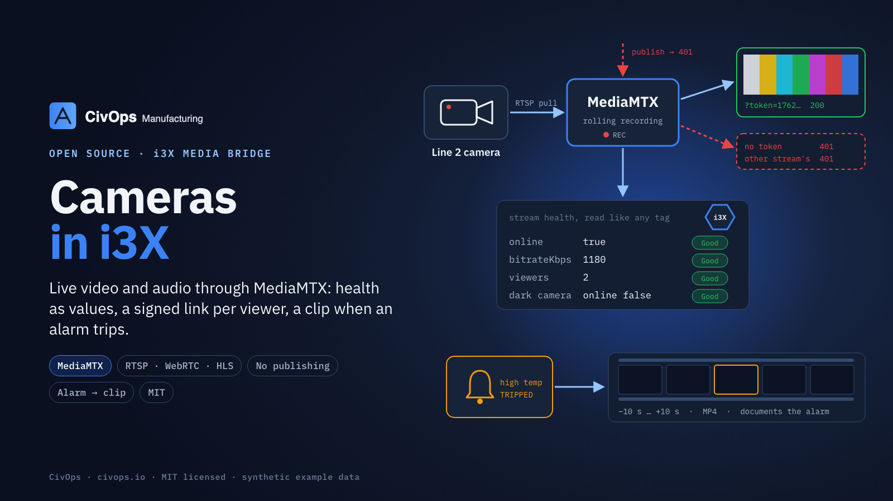

# i3X media bridge (MediaMTX)

Live video and audio for a [CESMII i3X](https://www.cesmii.org/) server through [MediaMTX](https://github.com/bluenviron/mediamtx), the open-source RTSP / WebRTC / HLS server. The stream bytes never pass through the i3X API; MediaMTX pulls each camera or microphone and serves viewers. This package does the parts an i3X server has to decide:



| Piece | What it does |
|---|---|
| `MediaMtxGateway` | registers a path per stream (pull from the device's RTSP URL, rolling recording), reads its health, cuts recorded clips |
| `MediaMtxDriver` | stream health as ordinary i3X values: `online`, `bitrateKbps`, `viewers`, `tracks` |
| `ViewerTokens` | a signed viewer URL per stream: HMAC-SHA256, one path only, expires (10 min default), stable within a minute so subscribers don't see churn |
| `authHandler` / `decide` | MediaMTX's HTTP auth hook: the server's own credentials for API and playback, a viewer only with a valid token for that exact path, **nobody publishes** |
| `ClipCutter` | alarm trips (Good quality, newly true or "active") → clip from `preS` before to `postS` after → your media store, as a MediaItem that documents the alarm and was captured by the stream |

Health is honest: a camera that sends nothing reads `online = false` at Good quality (a true statement about the camera); a gateway that does not answer turns every value Bad.

## Use

Requires Node 22 or later. No runtime dependencies. The package ships TypeScript source; run it with `tsx` or your own build.

```ts
import { createServer } from "node:http";
import { MediaMtxGateway, MediaMtxDriver, ViewerTokens, authHandler, ClipCutter } from "./src/index";

const gw = new MediaMtxGateway(
  { id: "gw", kind: "mediamtx", apiUrl: "http://gateway:9997", playbackUrl: "http://gateway:9996", viewerBase: "https://gateway:8889" },
  process.env.GW_USER!, process.env.GW_PASS!);
const tokens = new ViewerTokens(Buffer.from(process.env.VIEWER_KEY!, "hex"));   // 32+ random bytes

// 1. MediaMTX's authHTTPAddress points here.
createServer(authHandler({ user: process.env.GW_USER!, pass: process.env.GW_PASS!, tokens })).listen(8440);

// 2. One path per camera; health into your i3X value cache (any DriverSink).
await gw.ensurePath("line2-filler", "rtsp://camera-address/stream");
await new MediaMtxDriver({ id: "gw" }, () => gw).start(
  [{ attributeId: "cam:line2-filler/online", binding: { source: "gw", address: "line2-filler#online" } }], sink);

// 3. What an i3X read of the stream object returns as its viewerUrl.
tokens.viewerUrl(gw.cfg.viewerBase, "line2-filler");   // https://gateway:8889/line2-filler/?token=1762…

// 4. Alarm → clip.
const clips = new ClipCutter(gw, [{ trigger: "alarm:line2-high-temp", stream: "cam:line2-filler", path: "line2-filler", preS: 10, postS: 10 }],
  async (bytes, meta) => saveMediaItem(bytes, meta));   // your store; returns the new item's id
onValueChange((objectId, vqt) => clips.observe(objectId, vqt));
```

MediaMTX needs `authMethod: http`, `authHTTPAddress` at the bridge, `api: yes`, `playback: yes`, and `record`-friendly path defaults (fMP4, short segments); `config/test/mediamtx.yml` is a working example.

## Test

```bash
npm test                     # unit tests against a stand-in for MediaMTX's API and playback server
bash scripts/e2e-docker.sh   # real MediaMTX 1.9.3 + an ffmpeg test-pattern camera in Docker (Linux host), then removed
```

The end-to-end test checks live health values, that the signed token opens the RTSP stream and nothing else does, and that an alarm produces a real MP4 clip. Test passwords and keys are generated per run.

## License

MIT. See [LICENSE](LICENSE). From [CivOps](https://civops.io).
